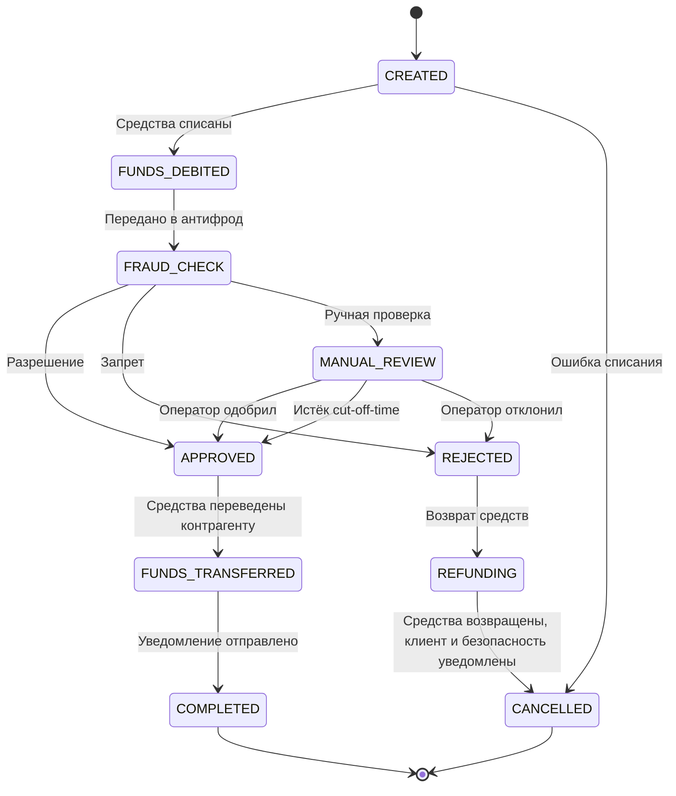
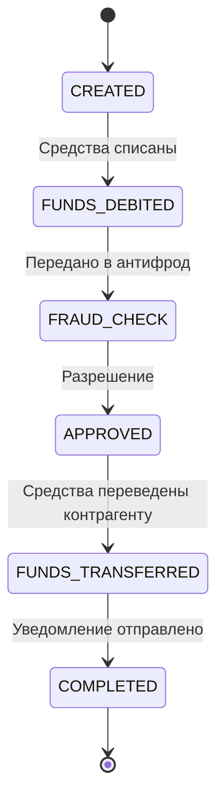
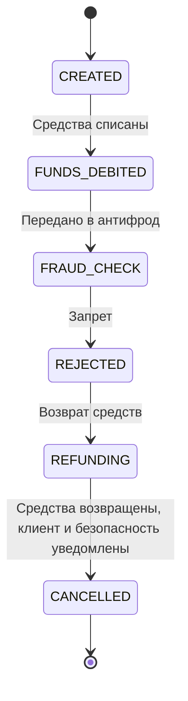
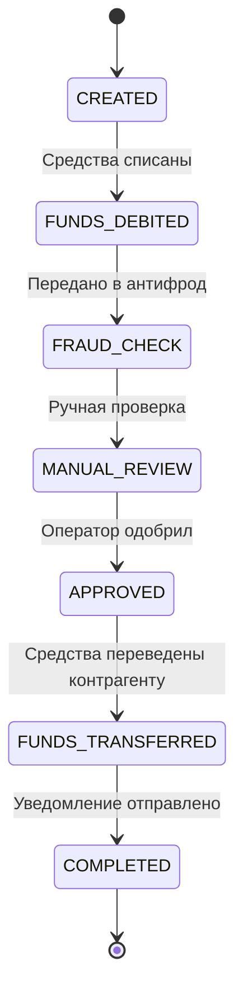
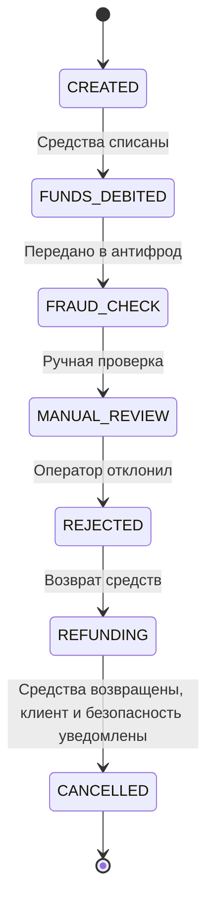
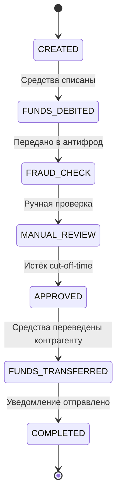
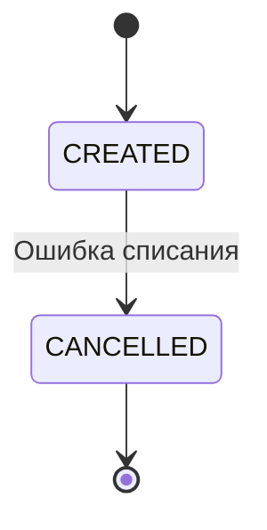

# Таблица переходов состояний платежа

## Состояния платежа

| Состояние | Описание |
|---|---|
| `CREATED` | Платёж создан в системе. |
| `FUNDS_DEBITED` | Средства списаны со счёта пользователя. |
| `FRAUD_CHECK` | Транзакция передана в антифрод-сервис на проверку. |
| `MANUAL_REVIEW` | Транзакция ожидает решения оператора. Таймаут: 20 минут. |
| `APPROVED` | Проверка пройдена. Транзакция одобрена. |
| `REJECTED` | Проверка не пройдена. Транзакция отклонена. |
| `FUNDS_TRANSFERRED` | Средства переведены контрагенту. |
| `COMPLETED` | Платёж завершён. Клиент уведомлён. |
| `REFUNDING` | Выполняется возврат средств пользователю. |
| `CANCELLED` | Платёж отменён. Средства возвращены. Клиент уведомлён. |

## Таблица переходов

| Исходное состояние | Переходное состояние | Событие |
|---|---|---|
| `CREATED` | `FUNDS_DEBITED` | Средства успешно списаны со счёта пользователя. |
| `CREATED` | `CANCELLED` | Ошибка при списании средств. |
| `FUNDS_DEBITED` | `FRAUD_CHECK` | Транзакция передана в антифрод-сервис. |
| `FRAUD_CHECK` | `APPROVED` | Антифрод-сервис вернул разрешение. |
| `FRAUD_CHECK` | `REJECTED` | Антифрод-сервис вернул запрет. |
| `FRAUD_CHECK` | `MANUAL_REVIEW` | Антифрод-сервис направил транзакцию на ручную проверку. |
| `MANUAL_REVIEW` | `APPROVED` | Оператор одобрил транзакцию. |
| `MANUAL_REVIEW` | `REJECTED` | Оператор отклонил транзакцию. |
| `MANUAL_REVIEW` | `APPROVED` | Истёк cut-off-time. Транзакция разрешена по умолчанию. |
| `APPROVED` | `FUNDS_TRANSFERRED` | Средства переведены контрагенту. |
| `FUNDS_TRANSFERRED` | `COMPLETED` | Уведомление о завершении платежа отправлено клиенту. |
| `REJECTED` | `REFUNDING` | Инициирован возврат средств пользователю. |
| `REFUNDING` | `CANCELLED` | Средства возвращены. Уведомление об отмене отправлено клиенту. Уведомление отправлено в систему безопасности. |

## Диаграмма состояний

## Сценарии

### Успешный платёж

### Отказ антифрод-сервиса

### Ручная проверка с одобрением

### Ручная проверка с отказом

### Срабатывание cut-off-time

Оператор не принял решение в установленный срок. Транзакция разрешена по умолчанию.

### Ошибка при списании средств

