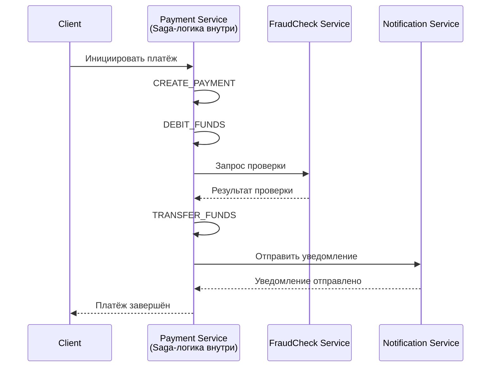
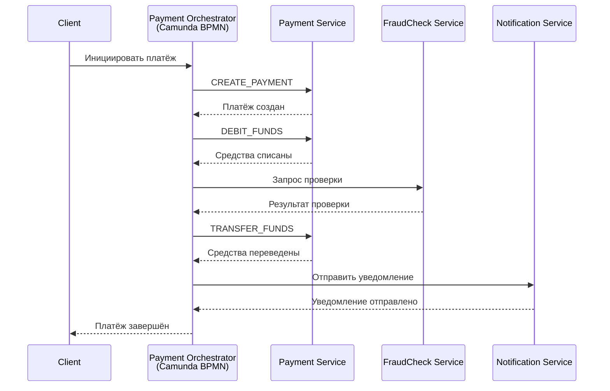

# ADR. Размещение функции оркестрации платёжного процесса

## Общая информация

Автор: Nurbek Sozoev; Статус: Принят

## Контекст

Платёжный процесс OrchestrPay включает пять шагов Saga: создание платежа, списание средств, антифрод-проверку, перевод контрагенту и отправку уведомления. Процесс содержит развилки: антифрод-сервис возвращает три типа ответа (разрешение, запрет, ручная проверка). При отказе требуется компенсация в обратном порядке. При ручной проверке транзакция ожидает решения оператора до 20 минут с механизмом cut-off-time.

Требования, влияющие на решение:
- SLA: 90% транзакций завершаются менее чем за 5 секунд.
- Состояние процесса фиксируется на каждом шаге для восстановления после сбоев.
- Бизнес и служба безопасности должны видеть, на каком этапе находится транзакция.
- Компенсационные транзакции выполняются автоматически.

Необходимо решить: разместить логику оркестрации внутри доменного сервиса Payment Service или выделить в отдельный сервис-оркестратор.

## Рассмотренные варианты

### Вариант 1. Оркестрация внутри Payment Service

Логика управления Saga размещается в Payment Service. Этот сервис хранит состояние процесса, принимает решения о переходах между шагами и запускает компенсации.

Payment Service берёт на себя две обязанности: обработку платежей и управление процессом. Состояние Saga хранится в той же базе PostgreSQL, что и данные платежей.

### Вариант 2. Отдельный сервис-оркестратор

Логика управления Saga выделяется в отдельный сервис. Оркестратор использует Camunda BPMN для исполнения процесса, хранит состояние Saga и координирует вызовы доменных сервисов. Payment Service отвечает только за операции с платежами.

Оркестратор управляет состоянием процесса через Camunda. Доменные сервисы выполняют только свои операции и не знают о порядке шагов Saga.

## Сравнение альтернатив

| Вариант решения | Преимущества | Недостатки |
|---|---|---|
| Вариант 1. Оркестрация внутри Payment Service | - Меньше сервисов в системе, проще деплой - Меньше сетевых вызовов между сервисами - Данные платежа и состояние Saga в одной базе, транзакционная консистентность | - Payment Service совмещает две обязанности: доменную логику и оркестрацию - Изменение процесса требует редеплоя Payment Service - Сложнее масштабировать оркестрацию и обработку платежей независимо - Camunda BPMN интегрируется в доменный сервис, увеличивая его сложность - Сбой Payment Service останавливает и оркестрацию, и обработку платежей |
| Вариант 2. Отдельный сервис-оркестратор | - Разделение обязанностей: оркестрация отделена от доменной логики - Camunda BPMN используется в выделенном сервисе, процесс описывается BPMN-схемой - Изменение порядка шагов Saga не затрагивает доменные сервисы - Независимое масштабирование оркестратора и доменных сервисов - Состояние процесса и трассировка доступны через Camunda Cockpit | - Дополнительный сервис в инфраструктуре - Дополнительные сетевые вызовы увеличивают латентность - Оркестратор становится единой точкой отказа, требуется обеспечить его отказоустойчивость |

## Принятое решение

Принят вариант 2. Отдельный сервис-оркестратор.

Обоснование:

1. Платёжный процесс содержит развилки, таймеры (cut-off-time, ожидание ручной проверки до 20 минут) и компенсационные транзакции. Camunda BPMN предназначена для исполнения таких процессов. Размещение Camunda в отдельном сервисе позволяет использовать её возможности: 
- визуализацию процесса
- управление таймерами
- автоматический запуск компенсаций

2. Требование прозрачности для бизнеса и службы безопасности выполняется через Camunda Cockpit. Видно, на каком шаге находится каждая транзакция, где произошёл сбой, какие транзакции ожидают ручной проверки.

3. Разделение обязанностей снижает риск каскадных сбоев. Payment Service, FraudCheck Service и Notification Service остаются независимыми. Изменение логики процесса (добавление шагов проверки, изменение порядка) не требует редеплоя доменных сервисов.

4. Дополнительная латентность от сетевых вызовов компенсируется тем, что основное время процесса приходится на операции со счетами и антифрод-проверку, а не на взаимодействие с оркестратором. SLA (5 секунд для 90% транзакций) достижимо при корректной настройке таймаутов и retry-механизмов.
